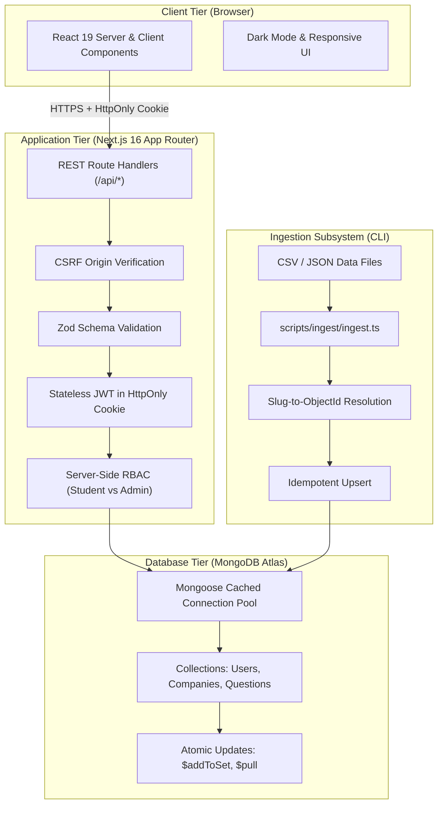

# Parakh (परख) — Project Presentation Slide Deck

A comprehensive 12-slide presentation outline for academic evaluations, college project vivas, and technical interview discussions.

---

## Slide 1: Title & Overview

### **Parakh (परख)**
*Company-wise Technical Interview Preparation Platform*

- **Presenter**: Computer Science Undergraduate Engineering Student
- **Platform Scope**: Full-Stack Web Application (Next.js 16 App Router, TypeScript, MongoDB Atlas, Tailwind CSS)
- **Tagline**: Helping students prepare for technical assessments and engineering interviews systematically.

---

## Slide 2: Problem Statement

### **The Challenges in Student Interview Preparation**
1. **Scattered Resources**: Practice problems are fragmented across LeetCode, company-specific discussion threads, Discord groups, and community spreadsheets.
2. **Lack of Company Context**: Students preparing for specific campus recruitment drives (e.g., Google, Amazon, Microsoft) lack a structured catalog of questions asked by those employers.
3. **No Readiness Analytics**: Traditional platforms track problem counts but fail to provide company-wise preparation readiness or difficulty breakdown metrics.
4. **Information Overload**: Thousands of uncategorized problems overwhelm 3rd and 4th-year students who have limited placement preparation windows.

---

## Slide 3: Proposed Solution

### **The Parakh Platform Approach**
1. **Targeted Company Catalog**: Browse and filter curated problems categorized by target technology hiring companies.
2. **Topic & Difficulty Grading**: Standardized categorization across CS algorithms (Arrays, Trees, Graphs, DP) and difficulty tiers (Easy, Medium, Hard).
3. **Personalized Progress Tracking**: One-click persistent bookmarking and solved question tracking.
4. **Real-Time Preparation Dashboard**: Visual analytics computing overall readiness percentages, difficulty distributions, and company-specific preparation completion bars.
5. **Administrative & Ingestion Subsystems**: Server-protected admin catalog management coupled with an idempotent bulk data ingestion CLI.

---

## Slide 4: Key Implemented Features

### **Verified Platform Functionality**
- **Company Catalog**: Searchable company directory with metadata and direct question filtering links (`/questions?company=slug`).
- **Question Catalog**: Multi-criteria search and filtering (keyword, difficulty, topic, company), safe sorting, and bounded pagination.
- **Question Detail Pages**: Dedicated views with external problem links, company tags, topic pills, and interactive bookmark/solved toggles.
- **Authentication System**: User registration, login, session inspection (`/api/auth/me`), and logout.
- **Preparation Dashboard**: Real-time progress statistics, difficulty breakdown, and company readiness bars.
- **Bookmarks & Solved Progress**: Dedicated user lists (`/bookmarks`, `/solved`) with inline removal actions.
- **Admin Management Panel**: Server-protected portal (`/admin`) for platform statistics and Company/Question CRUD with referential safety.
- **Bulk Data Ingestion CLI**: Standalone idempotent tool (`npm run ingest`) supporting RFC 4180 CSV and JSON files with dry-run verification.
- **Accessibility & UX**: System-detected zero-flicker Dark Mode, responsive mobile navigation drawer, and animated skeleton loading states.

---

## Slide 5: Technology Stack

| Layer | Technology | Engineering Purpose |
|---|---|---|
| **Framework** | Next.js 16 (App Router with Turbopack) | Server Components by default, co-located REST Route Handlers |
| **Language** | TypeScript 5 | Strict end-to-end type safety across client, server, and models |
| **User Interface** | React 19 & Tailwind CSS v4 | Interactive client islands, utility-first styling, native dark mode |
| **Database** | MongoDB Atlas with Mongoose ODM | Flexible document storage, schema enforcement, atomic set operations |
| **Authentication** | JWT (`jsonwebtoken`) & `bcryptjs` | Stateless session management with 10 salt rounds password hashing |
| **Validation** | Zod | Runtime schema validation on bodies, queries, slugs, and files |
| **Testing** | Vitest | Deterministic unit, security, validation, and ingestion test suites |
| **Deployment** | Vercel (Production Ready) | Edge network CDN routing with serverless function execution |

---

## Slide 6: System Architecture

### **End-to-End Application Flow**

Parakh is built as a three-tier monolithic application:

---

## Slide 7: Database Design & Relationships

### **Relational Document Schema**

- **User**: Profile data, hashed password (`select: false`), role (`student` | `admin`), and arrays of `bookmarkedQuestions` and `solvedQuestions` (ObjectIds referencing Question).
- **Company**: Unique `slug`, display name, logo URL, description, and website.
- **Question**: Unique `slug`, title, difficulty enum (`Easy`, `Medium`, `Hard`), topic tag array, external LeetCode URL, and `companies` (array of ObjectIds referencing Company).
- **Bookmark & Progress**: Decoupled join models maintained for backward compatibility with compound unique index `{ user: 1, question: 1 }`.

### **Referential Integrity & Atomic Operations**
1. **Company Reference Protection**: Company deletion is guarded with `Question.exists({ companies: company._id })`. If questions reference the company, deletion is blocked with `409 Conflict`.
2. **Atomic Status Updates**: Bookmarking and solving utilize `$addToSet` and `$pull` operators on `User`. Operations are completely idempotent and immune to race conditions.
3. **Graceful Deletion Handling**: If an admin removes a question, student dashboard queries use `$in` lookups and `.filter(Boolean)` to prevent broken references or UI crashes.

---

## Slide 8: Authentication & Security Architecture

### **Defensive Security Measures**
1. **HttpOnly Session Cookies**: JWTs are stored in `parakh_token` cookies with `httpOnly: true`, `SameSite: "lax"`, and `secure: true` in production, completely eliminating XSS token theft.
2. **Bcrypt Password Hashing**: Passwords hashed with 10 salt rounds before persistence; plaintext passwords are never stored, returned, or logged.
3. **Zero-Trust Server-Side RBAC**: Role enforcement (`requireAdmin`) verifies cryptographically signed JWT claims on the server. Client-supplied role flags are strictly ignored.
4. **CSRF Origin Verification**: State-changing endpoints (`POST`, `PUT`, `DELETE`) verify `Origin` and `Referer` headers against the host.
5. **NoSQL Injection & ReDoS Defense**: User search terms are escaped using `escapeRegex()`, query parameters are validated with Zod, and pagination is strictly bounded ($1 \le \text{limit} \le 50$).
6. **HTTP Security Headers**: Injected at the framework layer (`X-Content-Type-Options: nosniff`, `X-Frame-Options: DENY`, `Referrer-Policy: strict-origin-when-cross-origin`).

---

## Slide 9: Important Engineering Decisions

1. **Next.js App Router Monolith**: Co-locates React 19 UI with REST Route Handlers in a single repository, avoiding the complexity and deployment overhead of microservices.
2. **Stateless JWTs in HttpOnly Cookies**: Provides secure authentication without requiring an external centralized session store (such as Redis) while preventing client-side JavaScript exfiltration.
3. **Mongoose Connection Caching on `globalThis`**: Reuses a single database connection pool across Next.js dev server hot reloads and warm serverless invocations, preventing connection exhaustion.
4. **Zod Runtime Schema Validation**: Guarantees boundary validation across request bodies, URL slugs, and query parameters before reaching application logic or MongoDB.
5. **Idempotent CLI Data Ingestion**: Uses `slug` as the stable key for upserts. Running the same dataset multiple times results in zero duplicate documents and zero changed ObjectIds.
6. **Bulk Dashboard Aggregation**: Computes overall preparation, difficulty distribution, and company readiness in exactly 4 bulk database queries without $N+1$ query loops.

---

## Slide 10: Testing & Verification

### **Automated Quality Assurance**
- **Automated Test Suite (Vitest)**: 44 tests across 4 test suites passing with 100% success:
  - `tests/validation.test.ts`: Registration/login schemas, company/question schemas, bounded pagination, regex escaping.
  - `tests/auth.test.ts`: Token signing, verification, tampering rejection, cookie extraction, `requireAuth`, `requireAdmin`.
  - `tests/security.test.ts`: CSRF origin verification, safe GET allowance, cross-origin blocking (403).
  - `tests/ingest.test.ts`: RFC 4180 CSV parsing, quoted fields with commas, double-quote escaping, newlines.
- **Code Linter**: `npm run lint` passes with 0 errors and 0 warnings.
- **Production Build**: `next build` compiles all 27 App Router routes with Turbopack.
- **Production Server Smoke Test**: 24 automated end-to-end assertions passing against `http://localhost:3000`.

---

## Slide 11: Deployment & Serverless Readiness

### **Cloud Architecture on Vercel + MongoDB Atlas**
- **Edge Network & Serverless**: Static assets and pre-rendered pages cached globally on Vercel's Edge network; API route handlers execute as lightweight Node.js serverless functions.
- **Serverless Database Adaptation**:
  - `bufferCommands: false` in Mongoose prevents operations from queuing indefinitely during cold starts.
  - `serverSelectionTimeoutMS: 5000` ensures fail-fast database diagnostics.
- **Strict Secret Segregation**:
  - `MONGODB_URI` and `JWT_SECRET` are strictly server-only with no `NEXT_PUBLIC_` prefixes.
  - Production cookies automatically enforce `secure: true`.
- **Ingestion Decoupling**: Data ingestion runs via standalone CLI and is completely excluded from the production build bundle.

---

## Slide 12: Honest Limitations & Future Improvements

### **Current Limitations (By Design for Student Scope)**
- **No Social OAuth**: Google/GitHub OAuth omitted to avoid external OAuth credential dependencies.
- **No Automated Email**: Nodemailer/SMTP password reset deferred to avoid external mail server overhead.
- **Basic Substring Search**: Full-text searching uses MongoDB regex rather than an external engine (Elasticsearch).
- **CLI-Only Ingestion**: Ingestion is executed via the terminal rather than an admin web file upload to prevent file injection risks.

### **Future Roadmap**
1. Automated weekly email digest with recommended questions based on target companies.
2. In-browser code runner / sandboxed execution environment.
3. Company interview experience and round breakdown notes.
4. Granular topic mastery tracking with spaced repetition algorithms.
